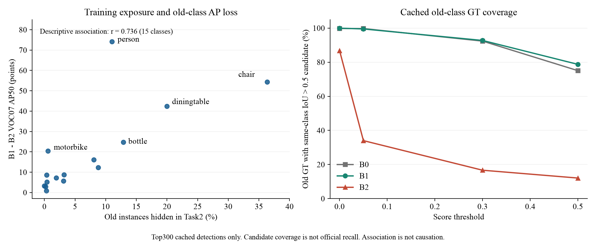
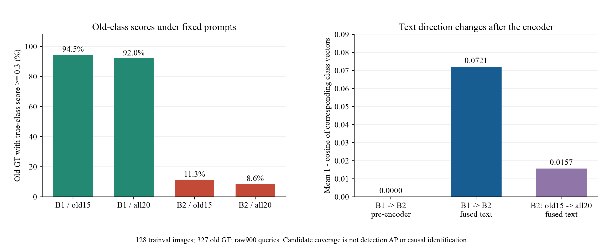

# 首轮遗忘机制诊断

日期：2026-11-04。结论范围：一个seed、固定VOC07字母类序、已有Single LoRA B0/B1/B2。没有新增训练，没有改动基线协议。这里只定位现象，不认定创新点，也不把相关性写成机制因果。

## 当前最有依据的判断

旧类下降伴随明显的分数尺度变化和缓存候选保留变化；下降在新旧类别共现场景更大，并与训练时旧物体漏标暴露相关。完整900query配对探针进一步确认：在固定128张训练侧图像上，旧类几何候选仍存在，但高IoU候选的同类分数大幅降低；移除新增类评测提示也未明显恢复。编码器前文本完全一致，增强后文本方向、范数与类间关系发生变化。现有证据不能直接推出“定位完全保留、文本语义遗忘”，也没有证明跨模态拓扑漂移是主因。下一步应从同一B1执行Task2训练提示new5/all20的单变量对照，检查漏标负监督与提示条件。



## 1. 数据与评价控制

- 复用完整4952图test的真实B0/B1/B2缓存预测，逐一校验原始SHA256，按文件名将旧整数image_id映射到新XML转换数据。
- B1、B2原始正式评价均使用同一个20类prompt。因此，原主表的19.1322点旧类VOC07 AP50下降，不能归因于两个模型在评测时用了不同类别提示集合。训练阶段的prompt变化仍与监督变化共同发生，需要另外对照。
- 所有图像和GT只做只读诊断；没有将隐藏标注用于优化、伪标签生成或checkpoint选择。test上的错误分析不作为调参选择规则；后续特征探针使用训练侧固定样本。
- score阈值预先固定为0、0.05、0.3、0.5，IoU严格>0.5；不按结果挑阈值。AP计算不加这些分数阈值，完整重算与原正式old15 AP一致。
- 缓存为原生输出top300，不是所有900个raw query。下面的GT候选覆盖允许同一预测覆盖多个GT，不是标准一对一recall，不是TIDE的因果dAP分解。

## 2. 控制类别组成后的共现场景差异

test中有旧类单独场景3972图、新旧类共现414图、新类单独566图。新旧共现组缺少aeroplane非difficult正例，因此不能拿其14类宏平均与另一组15类宏平均直接比较。下表两组统一使用共同14类。

|场景|图像数|B1 VOC07 AP50|B2 VOC07 AP50|下降点数|
|---|---:|---:|---:|---:|
|仅旧类，统一14类|3972|90.9243|70.8908|20.0335|
|新旧类共现，统一14类|414|91.2969|51.9739|39.3230|

部分共现类别只有1–4个GT，所以额外检查最低支持量：两组都至少20个GT的7类（bottle/car/cat/chair/diningtable/dog/person），旧类单独/新旧共现下降分别32.4277/45.7387点；两组都至少50个GT只剩chair/person，分别61.7640/72.1799点。该分析减轻宏平均类别构成和极少正例的影响，但没有控制对象尺度、遮挡、场景复杂度等，因此仍不是共现的因果效应。

## 3. 旧类的高IoU候选和分数

分母为10481个旧类非difficult test GT。“同类候选”要求类别正确且IoU>0.5；“任意类框”只要求IoU>0.5。均来自同一原始top300缓存。

|score门槛|B1任意类框覆盖%|B2任意类框覆盖%|B1同类覆盖%|B2同类覆盖%|
|---|---:|---:|---:|---:|
|0|99.9618|97.7578|99.9523|86.7856|
|0.05|99.6661|40.4923|99.4943|34.0139|
|0.3|93.9700|19.8550|92.7488|16.6587|
|0.5|80.0878|14.2544|78.7329|12.0695|

在B1、B2缓存中都存在同类IoU>0.5候选的9095个旧GT上，各模型该GT最高同类候选分数的中位数从0.82234降至0.01549；93.18%的配对GT分数降低。这里匹配的是同一GT，不是假定跨模型同序号query对应。该统计条件化于双方缓存均有同类候选；其余缺失值为null，不当作模型概率0。

这些结果支持“固定部署阈值下旧类检出可靠性严重退化”和“缓存的类别候选集合发生变化”。它们不能单独解释AP下降：在候选集固定时，类别内统一的严格单调分数变换不改变AP排序。需要继续检查类内排序、截断前的900query，以及是否真的丢失对应区域。相关不变量已加入单元测试。

分数阈值0.3下旧类GT候选bins：B1同类正确定位9721、其他类正确定位128、无候选交叠339；B2分别1746、335、7623。其余为部分交叠。这些是阈值条件下的描述性候选bins，不可直接称为7623个“定位遗忘”。

## 4. Task2的旧物体漏标暴露

Task2的1006图中，468图含非difficult旧物体，共1052个旧类框在当前阶段不提供标注。这是每次遍历数据池的实例数，不是累加12epoch后的曝光次数。

|类别|Task2中隐藏的旧框|占该类trainval实例比例|B1→B2 AP50下降|
|---|---:|---:|---:|
|person|516|11.00%|74.1651|
|chair|290|36.34%|54.3922|
|diningtable|43|20.00%|42.4109|
|bottle|65|12.87%|24.6860|
|motorbike|2|0.59%|20.3850|
|bus|0|0.00%|3.2408|

15个旧类上，隐藏实例占比与遗忘点数的Pearson r=0.73599。样本只有15个类别，存在类别语义、难度和场景混杂，不报告因果解释或未经设计的显著性主张。motorbike暴露很少却明显下降，bus无直接Task2旧框暴露仍有下降，说明单一暴露比例不是完整解释。

结合原生all20训练prompt和未标注旧对象的负监督机制，漏标背景冲突是应优先控制的解释之一；不能因此认定更细的类别参数隔离或跨模态保持没有价值。GCD等已有方法已经处理部分漏标/保持问题，本结果本身不是新颖性证明。

## 5. 完整128图固定checkpoint探针

先根据trainval标注、seed20261104独立固定128张图（64旧类单独+64新旧共现），未按模型输出来选图。该组包含327个旧类非difficult GT、覆盖全部15个旧类。清单见evidence/diagnostics/v1/prompt_probe_plan.json；其中not_run_GPU2_busy是清单建立时的历史快照，最新完成状态见status.json及full_probe/completion.json。

GPU2开始被其他作业占用，第一次空闲检查拒绝启动。后来释放后，在用户既有GPU2授权内完成了B0/B1/B2 × old15/all20六组前向，保持短边800/长边≤1333、900query。总计771次前向（768次配对条件+3次重复数值检查），无optimizer、无训练，冻结参数与LoRA均未变。三次同条件重复的logit/box最大差异均为0。

### 5.1 完整query排除了仅由top300截断造成的解释

同一327个旧GT在六个条件下均有至少一个raw query框满足IoU>0.5。该结果说明这一固定训练侧样本上仍存在几何候选，不意味着标准一对一召回率或正式定位AP为100%。900个候选本身较多，也不能据此断言全test定位能力完整保持。

|模型/提示|raw query框覆盖%|同类分数≥0.3的GT覆盖%（实例平均）|同类分数≥0.3覆盖%（15类等权）|
|---|---:|---:|---:|
|B0 / old15|100|96.3303|93.1329|
|B0 / all20|100|94.1896|89.3242|
|B1 / old15|100|94.4954|94.3405|
|B1 / all20|100|92.0489|93.3165|
|B2 / old15|100|11.3150|39.3187|
|B2 / all20|100|8.5627|35.5975|

实例平均受person等高频旧类影响，故同时报告15类等权结果；部分少见类GT较少，不能据此替代完整test宏平均AP。全部条件按同一批GT比较，原始raw900分数使用原生token sigmoid均值聚合，与缓存top300截断无关。

B2去掉新增类提示后仅从8.56%恢复到11.31%（阈值0.3、实例平均），未恢复到B1。固定20类提示时，每个GT的高IoU候选中最高同类分数，中位数从B1的0.77556降至B2的0.001656；这些值来自全900query，不是将缓存缺失值填零。原baseline下降因此不能只用评测时的新增类提示或top300截断解释。

### 5.2 融合前文本不变，融合后方向和关系发生变化

B1→B2、固定all20提示，在128图×15类对应向量上：

|位置/指标|实测|
|---|---:|
|进入encoder前文本投影特征最大绝对差|0|
|encoder输出融合文本的平均对应余弦|0.9279304|
|融合文本均值范数：B1→B2|5.9722→6.5920|
|融合文本类间余弦矩阵平均绝对变化（非对角）|0.0490597|
|B2内old15→all20提示，融合文本平均对应余弦|0.9843345|

这验证了冻结BERT/投影不保证增强器输出文本不变；变化出现在后续encoder处理之后。本基线只训练视觉和文本encoder的FFN LoRA，fusion attention权重本身冻结，因此不能写成“BERT被更新”或“融合层权重被微调”导致这些变化。

向量方向、范数和类间关系分别统计：对应余弦改变与范数增加并存，不是单一均匀缩放；类间余弦变化也不等于GCD的欧氏原型CTD损失。最高IoU query的范数/文本余弦列仅是辅助几何探针，该query未必是最高同类分数的query，不将它当成唯一跨模型语义对应或因果证据。



### 5.3 能缩小到的研究问题

现在有依据优先研究：**在完整预训练+共享FFN LoRA的顺序CIOD中，为何几何候选仍可用、冻结的文本输入也未变，但增强后文本与区域打分关系出现有害的功能变化？** 这不是已证明的新颖问题，更不能仅凭余弦0.9279认定有害；有害性线索来自同一对象的raw query分数、完整test AP下降和漏标暴露的联合观察。

下一项最小训练对照应从同一个B1开始，固定Task2图像、GT、步数、seed和LoRA范围，仅改变训练提示为new5或累计all20，再用同一固定probe及统一all20评价。它有助于检验旧类负监督/提示条件，而不是立即引入专家或复杂蒸馏。之后才考虑一个明确query对应的基础KD或伪标签对照。本轮没有自动启动这些新增训练。

完整复跑命令（本轮已经执行成功，不要重复提交）：

```bash
python scripts/probe_prompts.py --runtime configs/runtime.local.json \
  --reference-root /home/data/dq/dgs-experiments/gdino_ciod_voc15_5 \
  --gpus 2 --images 128 --plan evidence/diagnostics/v1/prompt_probe_plan.json \
  --out outputs/prompt_probe_v1
python scripts/analyze_prompt_probe.py --input outputs/prompt_probe_v1 \
  --out outputs/prompt_probe_analysis_v1
```

## 6. 验证、成本与材料

21项单元测试通过；覆盖空候选、difficult、重复预测、混淆矩阵方向、阈值与AP的区别、选择可复现性及已有基线测试。CPU完整路径探针smoke约28秒，完整缓存分析约154.47秒；完整GPU2探针计时区间186.66秒（初次模型构建另计），峰值allocated显存1.462 GiB。完整GPU探针1次成功完成，新增正式训练0次。

原始输入预测/权重保持原位且校验hash。新增可复核文件：summary.json、analysis.json、per_class_stratum_ap.csv、task2_hidden_old_exposure.csv、confusions_score03.csv、object_trajectories.csv。完整GPU探针的completion、selection、逐对象分数和派生summary另在full_probe中；较大的text_features.npz保留服务器outputs/prompt_probe_v1，以SHA256追溯。所有结论区分正式AP、raw-query/缓存候选覆盖和CPU工程验证。

服务器完整原始特征：`/home/data/dq/gcd-ciod-20261104/outputs/prompt_probe_v1/text_features.npz`，SHA256 `9f82dad0301a1cee0c5bf3c8470178aa0abfb9a6df24a7b75425dc68ec88024d`。本地证据目录中的deployment.json记录最终源码核对、21项测试及原始文件位置；code_manifest.json记录9个新增诊断源码的SHA256，原基线25个源码文件保持原hash。
