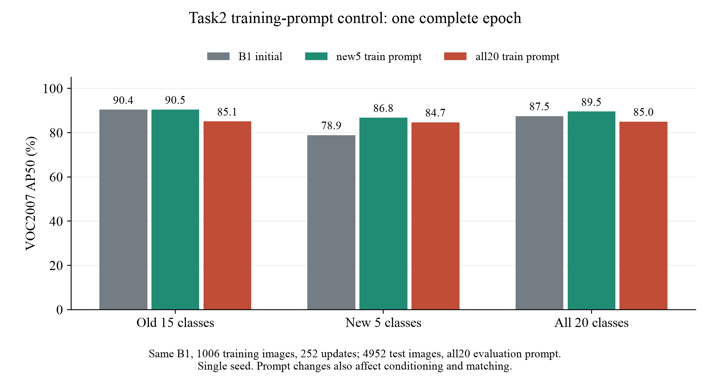

# Task2训练提示单变量对照：预注册与完整结果

用户授权继续研究、仅使用GPU2，每项任务完成后提交并推送GitHub。已完成的基线与机制诊断提交433c2ce、b5bafce已上传main。本对照在hugo/task2-prompt-control分支保留过程。

资源授权更新（2026-11-05）：用户允许在物理GPU0–3中选择空闲卡。两组训练已经在GPU2完成；all20的第一次GPU2评价在900图进度后因并行负载而主动迁移。GPU1连续三次利用率0%、可用显存7865MiB，满足评价的6GiB空余门槛，故从头执行完整4952图。仅向本项目自己的评价父进程发送SIGINT，未操作其他作业。中断日志与配置保留在evaluation_attempts，未用于AP；新旧模型/数据/评价配置逐项完全一致。物理卡和CPU线程数记录在新评价provenance中。

## 问题与预算

首轮诊断发现：旧类高IoU候选的打分下降，移除评测新增类提示未明显恢复，Task2存在1052个隐藏旧框。先检验训练提示是否影响早期旧类保持，不引入新方法。

固定同一真实B1（SHA256 af92d30f638a4d74634185c50129320257d1616462bb87966dba27ea0d0f471e）、seed20261103、Task2全部1006图/1640个新类框、FFN LoRA r16/alpha32、原生损失、900query、原多尺度、batch2/累积2、AdamW lr1e-4。两组都完整训练1epoch、503微步、预计252次更新；最后不足一个累积批次按原生MMEngine处理。学习率全程固定，优化器均从头建立，未沿用B1动量。

- new5：文本仅pottedplant/sheep/sofa/train/tvmonitor，数据集局部label为0–4。
- all20：文本为完整20类，同一新类GT的局部label为15–19。

每批记录图像ID、增广后像素、GT框和还原到全局空间的类别hash。两组必须完全一致；不把局部标签重编号当成监督差别。首批还核验原生正token映射实际对应正确类别。记录初始LoRA hash、冻结参数hash、有效更新和AMP跳步。

两组纯训练预计约9–10分钟，模型加载、checkpoint、hash与完整test评价另计。该预算来自GPU2已测503微步/epoch，不是完成时间承诺。先各8微步预检，再执行固定1epoch；预检checkpoint不进入正式对照。

## 预定评价与解释范围

固定最后一个epoch，不按test结果选择checkpoint或seed。两个模型统一all20 prompt，在完整4952图VOC07 test评价VOC07 AP50、COCO AP50/AP50:95及逐类15/5/20类平均；与相同B1比较保持和新类变化。先检验输入配对和优化有效性，通过后才比较结果。

这是一轮单seed的1epoch机制筛查，不替代12epoch基线。若new5保持旧类更好，还须检查新类适应是否同步减弱。new5同时改变文本条件、query选择及匹配，不能把差异全部解释为纯粹移除负损失通道。若没有明显改善，则训练提示负监督不足以独立解释遗忘。无隐藏旧标注进入优化，无旧样本回放，无KD。

固定官方源码的GroundingDINOHead先将所有query-token目标初始化为0，仅在匹配位置填入当前GT的positive_maps，再用有效text_mask筛选分类损失（[固定commit源码](https://github.com/open-mmlab/mmdetection/blob/44ebd17b145c2372c4b700bfb9cb20dbd28ab64a/mmdet/models/dense_heads/grounding_dino_head.py#L190)）。因此，all20中的旧类token有效且没有旧类正目标，确实存在负监督；但这不证明该通道是功能下降的唯一来源。后续若需隔离损失作用，应保留all20完整前向条件，仅控制旧类token的分类损失，再检查query匹配与新类适应。

## 运行与材料

使用scripts/prepare_prompt_control.py生成不可覆盖的plan.json，固定数据、权重、源码与预算hash；scripts/train_prompt_control.py复用未修改的baseline dry-run配置，仅覆盖已注册的提示/标签和训练预算。配置模板与实际配置分开保留。所有输出使用新目录，失败日志不覆盖。

计划与最终结果放在evidence/prompt_control/v1；模型和大型预测留在服务器outputs。完成后在本报告追加真实结果，不用预期代替实测。

## 预检结果

23项单元测试通过。new5/all20均完成完整分辨率、900query的8微步GPU2预检，各4次有效更新、无AMP跳步，48个LoRA张量更新、冻结参数不变。两组8批的图像ID、增广像素和全局GT指纹完全一致，初始LoRA hash相同；原生正token监督实际指向相同新类别。预检模型不进入后续对照，两个1epoch模型都重新从相同原始B1初始化。证据见evidence/prompt_control/v1/preflight_pair.json及preflight目录。

预注册与预检已在任何1epoch对照结果产生前提交并推送：d44c865。以下为服务器复现命令模板；目录已存在时拒绝覆盖，不要重复提交已运行的实验。

```bash
python scripts/train_prompt_control.py --runtime configs/runtime.local.json \
  --init /home/data/dq/dgs-experiments/gdino_ciod_voc15_5/checkpoints/task1_15classes.pth \
  --arm new5 --plan evidence/prompt_control/v1/plan.json --out outputs/prompt_control_v1/new5
# all20组仅替换--arm和--out，仍从同一原始B1初始化。
python scripts/run.py eval --runtime configs/runtime.local.json --gpus 2 --phase task2 \
  --init outputs/prompt_control_v1/new5/epoch_1.pth --work-dir outputs/prompt_control_v1/new5_eval
python scripts/evaluate.py --manifest data/voc15_5/manifest.json \
  --predictions outputs/prompt_control_v1/new5_eval/predictions.bbox.json \
  --provenance outputs/prompt_control_v1/new5_eval/provenance.json \
  --model B2 --out outputs/prompt_control_v1/new5_results
# all20评价也仅替换对应目录；脚本内B2表示Task2评价接口，不是12epoch历史基线。
python scripts/summarize_prompt_control.py --root outputs/prompt_control_v1 \
  --plan evidence/prompt_control/v1/plan.json \
  --reference-summary /home/data/dq/dgs-experiments/gdino_ciod_voc15_5/results/B1/summary.json \
  --out outputs/prompt_control_v1/analysis
```

## 固定1epoch训练实测

完整输入配对通过：两组503批、1006个不同图像的顺序、增广像素、框与全局类别指纹完全一致；初始LoRA相同。两组均252次有效更新、0次AMP跳步、48个LoRA张量更新，冻结参数不变。

|训练提示|微步/更新|审计区间秒|峰值allocated GiB|
|---|---:|---:|---:|
|new5|503 / 252|277.21|6.435|
|all20|503 / 252|280.69|7.291|

以上计时不含初次模型构建；完整评价另计。完整评价结果见下方已完成汇总。详见evidence/prompt_control/v1/paired_training.json及training目录。

## new5完整评价核查（2026-11-05）

new5固定1epoch模型已完成4952图test，评价提示统一all20；原始完成日志为11月4日。VOC07 AP50：旧15类90.4654，新5类86.7800，全部20类89.5440。相对初始B1，旧类+0.0604、新类+7.8497点。COCO AP50:95分别81.5624/76.7948/80.3705。

这是已完成的单组结果；all20组训练已完成，完整评价在本次核查后启动。该单组阶段尚未进行两组比较；后续完整对照见下方。证据见evidence/prompt_control/v1/evaluation/new5；大型原始预测留在服务器，并记录路径与SHA256。

## 评价初始化修正（2026-11-05）

GPU迁移入口最初漏掉了runner._init_model_weights()。本项目的自定义checkpoint加载位于init_weights，故该次GPU1近零AP不能代表训练checkpoint，已明确作废并保留日志、预测路径、无效指标与当时源码（d26e025）。该结果不进入最终比较，不能解释为模型灾难性崩溃。GPU2此前的900图中断尝试也未计入AP。

修复提交698655c显式初始化，并在任何前向前将全部948个状态张量与请求的checkpoint逐一比较，完全一致后才允许评价。新增回归测试覆盖正常加载和遗漏/错误加载的拒绝，当前28项测试通过。4张固定训练图的完整分辨率/900query预检输出正常，仅作工程验证。两组训练checkpoint保持原样；修正后只重跑all20评价。

## 完整配对结果（2026-11-05）

两组均完成固定1epoch、503微步、252次有效更新与完整4952图评价；统一all20评价提示。B1为同一真实起点，表中的两个新模型不是12epoch历史B2。

### VOC2007 11点AP50

|状态|旧15类|新5类|全部20类|
|---|---:|---:|---:|
|B1起点|90.4050|78.9303|87.5363|
|new5训练提示|90.4654|86.7800|89.5440|
|all20训练提示|85.1257|84.7089|85.0215|

### COCO风格AP50，仍在VOC测试集

|状态|旧15类|新5类|全部20类|
|---|---:|---:|---:|
|B1起点|95.7627|81.8120|92.2751|
|new5训练提示|95.8389|91.2707|94.6968|
|all20训练提示|89.7989|88.6706|89.5168|

### COCO风格AP@[0.50:0.95]，仍在VOC测试集

|状态|旧15类|新5类|全部20类|
|---|---:|---:|---:|
|B1起点|81.5731|68.9695|78.4222|
|new5训练提示|81.5624|76.7948|80.3705|
|all20训练提示|76.2210|74.7986|75.8654|

new5−all20的VOC07 AP50差异：旧类+5.3396、新类+2.0711、全部类+4.5225点。相对相同B1，new5旧/新类变化+0.0604/+7.8497点，all20为-5.2792/+5.7786点。应联合比较保持与适应，不能只报旧类收益。

旧类中绝对差异最大的5类，仅作事后描述；完整20类见CSV：

|类别|B1|new5|all20|new5−all20|
|---|---:|---:|---:|---:|
|person|90.0934|89.9609|68.4735|21.4874|
|diningtable|86.9526|86.5433|65.3106|21.2328|
|chair|84.5743|84.5762|68.4376|16.1386|
|dog|94.1370|95.1240|90.2964|4.8275|
|bottle|87.5925|87.8778|83.4739|4.4038|



### 能支持的解释与下一步

本轮测量训练提示选择对保持—适应结果的影响，不认定唯一因果来源或新颖性。两组初始权重、训练图像/增广像素/全局GT、seed、原生损失和更新预算一致；局部标签重编号已核验。首批有效文本token为17/51，原生分类损失按匹配目标数归一化，并未按文本token数归一化，因此提示改变也会改变负项数量和分类/回归相对作用，同时改变文本条件、query选择与匹配。

下一项更清楚的机制对照是保持all20完整前向，只控制旧类token的分类损失，并检查token损失归一化与新类适应；先做短程筛查，再决定是否12epoch和多seed复核。这里没有将新的AP差异归因为融合文本漂移：首轮128图表示探针对象是历史B0/B1/B2，本轮两个新checkpoint尚未重跑同一表示探针。

### 完成与复现校验

28项单元测试通过。all20正式采用的评价逐一核对948个状态张量与checkpoint一致，再完成4图原分辨率/900query工程预检。两组完整test完成日志、原始预测SHA256与checkpoint链均核对；遗漏初始化的一次完整评价以及两次GPU2中断尝试均排除。训练仍是GPU2；new5完整评价为GPU2，最终all20完整评价为显式指定的GPU1，均为RTX3090。新评价入口的CPU线程和准入采样记录在provenance中，不能把硬件负载下的评价时间当成方法效率比较。

完整汇总见[summary.json](../../evidence/prompt_control/v1/analysis/summary.json)、[逐类比较](../../evidence/prompt_control/v1/analysis/per_class_comparison.csv)和[部署核验](../../evidence/prompt_control/v1/deployment.json)。大型checkpoint与预测保留服务器，Git中记录路径和SHA256。

有限流水线入口scripts/execute_prompt_control.py可连续执行各阶段，复用经核对的完成标记，并拒绝覆盖未完成目录。当前已用--validate-only对全部已完成阶段核验，不重复训练或推理；该入口针对已注册的v1训练预算，后续新试验需另建plan。

```bash
python scripts/execute_prompt_control.py --runtime configs/runtime.local.json \
  --init /home/data/dq/dgs-experiments/gdino_ciod_voc15_5/checkpoints/task1_15classes.pth \
  --plan evidence/prompt_control/v1/plan.json \
  --reference-summary /home/data/dq/dgs-experiments/gdino_ciod_voc15_5/results/B1/summary.json \
  --out outputs/prompt_control_v1 --validate-only
```

补充资源记录：一次初始化正确的自动重跑在GPU2短时低利用率时被准入，随后拥塞，在780图进度后中断并保留。最终有效all20评价显式指定--gpu 1，provenance确认物理GPU1，完整4952图均来自这一次运行；没有拼接不同尝试的预测。
